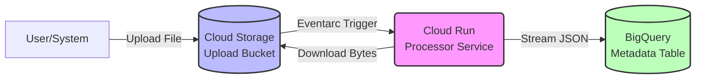

# Serverless Event-Driven Document Processing Pipeline

An end-to-end, event-driven serverless architecture built on Google Cloud. When files are uploaded to Cloud Storage, Eventarc triggers a Cloud Run service that "processes" the document (simulates OCR) and streams the metadata into BigQuery using the low-latency Storage Write API.

## Architecture



## Features
- **Fully Serverless**: Scales to zero, charges per execution/gigabyte processed.
- **Event-Driven**: Uses Eventarc for reliable, explicit event delivery (no manual Pub/Sub wiring required).
- **Modern Streaming**: Integrates with BigQuery's Storage Write API natively using compiled Protocol Buffers for high-throughput, low-latency metadata ingestion.
- **Infrastructure as Code**: Terraform configuration defines least-privilege IAM, the dataset, bucket, Cloud Run service, and Eventarc trigger.

## Project Structure
```text
├── terraform/          # GCP Infrastructure provisioning
├── processor/          # Python Cloud Run Service
│   ├── main.py         # Application Logic
│   ├── metadata.proto  # Protobuf schema for BQ Storage Write API
│   ├── Dockerfile      # Container definition
│   ├── requirements.txt
│   └── tests/          # Unit tests (pytest)
└── README.md           # This file
```

## Deployment Guide

### 1. Prerequisites
- Google Cloud Project with billing enabled.
- `gcloud` CLI installed and authenticated.
- `terraform` installed.
- APIs enabled: `run.googleapis.com`, `eventarc.googleapis.com`, `storage.googleapis.com`, `bigquery.googleapis.com`, `bigquerystorage.googleapis.com`.

### 2. Deploy Infrastructure (Placeholder)
Because Cloud Run requires an image to be deployed, we will first provision the infrastructure using a placeholder Google image.

```bash
cd terraform
terraform init
terraform apply
```
_Take note of the `upload_bucket` output name._

### 3. Build & Deploy the Processor Code
Build your container image and submit it to Artifact Registry or GCR, then deploy it to the Cloud Run service created by Terraform.

```bash
# Set your project and region
PROJECT_ID="YOUR_PROJECT_ID"
REGION="europe-north1"

# Build image (Cloud Build is convenient here)
cd ../processor
gcloud builds submit --tag gcr.io/acoustic-result-510818-m5/doc-processor

# Deploy the real code to the Cloud Run service
gcloud run deploy doc-processor \
  --image gcr.io/acoustic-result-510818-m5/doc-processor \
  --region $REGION
```

### 4. Test the Pipeline
Upload any file (e.g., a `.txt` or `.pdf` file) to the GCS upload bucket created by Terraform.

```bash
echo "This is a test document with some sample words for simulated OCR" > sample.txt
gsutil cp sample.txt gs://<YOUR_UPLOAD_BUCKET_NAME>/
```

Wait a few seconds, then query BigQuery:
```sql
SELECT * FROM `document_processing.metadata` ORDER BY upload_date DESC LIMIT 5
```

## Local Testing
To run the unit tests locally (which use mocked GCP clients):
```bash
cd processor
pip install -r requirements.txt
pip install -r tests/requirements-test.txt
pytest tests/
```
